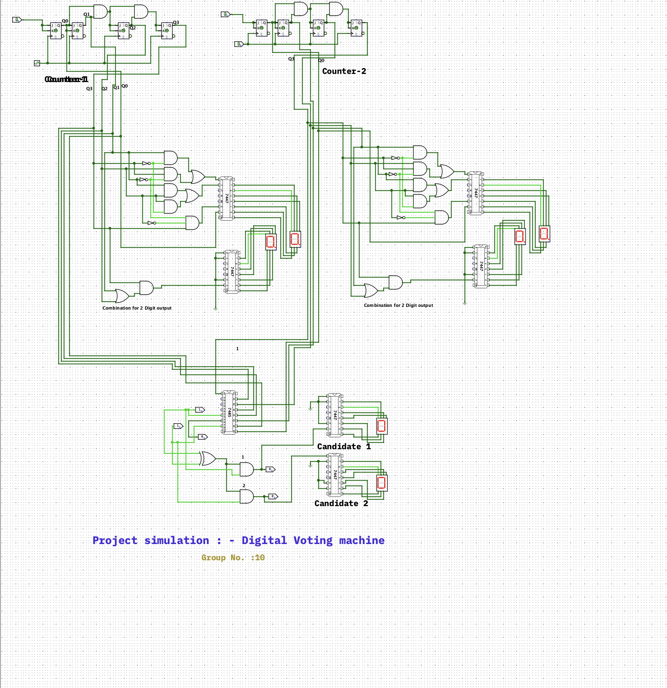
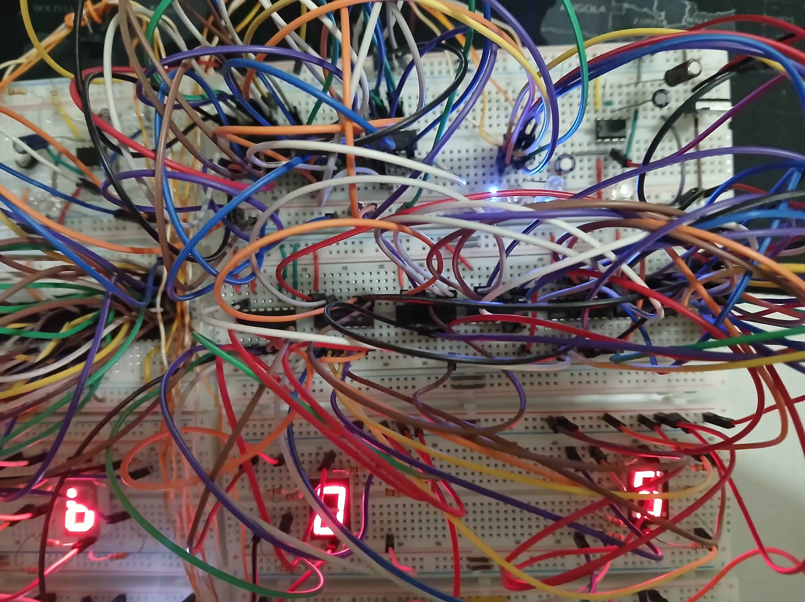
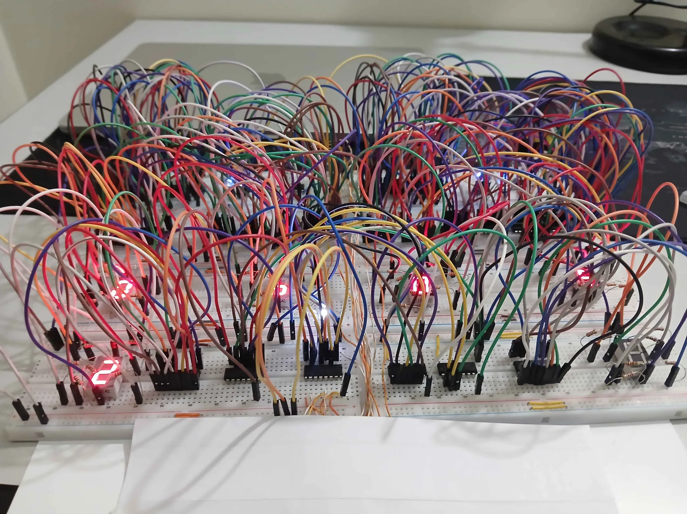

# CSE231 - Digital Logic Design

Course project for CSE 231.

## Team

- [konokuzzaman](https://github.com/konokuzzaman)
- [shishirbaidya](https://github.com/shishirbaidya)

## Digital Voting Machine

A Digital Voting Machine can be designed using JK flip-flops, where each candidate’s vote is stored and incremented using a 4-bit synchronous counter built from cascaded JK FFs. Every time a voter presses a button, the corresponding counter increments by 1, and the JK flip-flops toggle based on the required count sequence.

## Circuit Design

The circuit was built and simulated in Logisim (`project.circ`).

## Hardware Implementation

  
  

## How to Open

Open `project.circ` in [Logisim Evolution](https://github.com/logisim-evolution/logisim-evolution).
